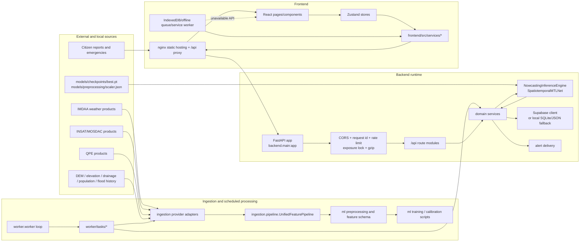

# BharatRiskAI Architecture Audit

**Scope:** Phase 1 audit of the repository as found on 2026-11-05. This document records observed structure and execution paths; it does not claim that external providers, production credentials, or live observations were available.

## Repository shape

| Area | Observed location | Runtime role |
|---|---|---|
| API service | [`backend/main.py`](../backend/main.py) | FastAPI application, middleware, startup artifact validation, route registration |
| API routes | [`backend/api/`](../backend/api/) | Health, dashboard, nowcast, zones, reports, emergencies, recommendations, satellite |
| Domain services | [`backend/services/`](../backend/services/) | Risk, nowcast, reports, emergencies, recommendations, state, geospatial, alerts |
| Provider ingestion | [`ingestion/`](../ingestion/) | Weather, INSAT, IMDAA, QPE, satellite, elevation, DEM, population, drainage, flood-history adapters |
| ML runtime | [`ml/nowcasting/`](../ml/nowcasting/), [`ml/models/`](../ml/models/) and [`deep_learning/architectures/`](../deep_learning/architectures/) | Feature construction, checkpoint loading, multi-task inference, neural architectures and baseline/risk model loading |
| Offline/training pipeline | [`ml/preprocessing/`](../ml/preprocessing/), [`ml/training/`](../ml/training/), [`scripts/`](../scripts/) | Dataset validation, feature transforms, training, calibration, evaluation, replay |
| Scheduled worker | [`worker/worker.py`](../worker/worker.py) | Periodic satellite/weather sync, risk update, report processing, alert processing |
| Persistence | [`backend/database/`](../backend/database/), [`backend/database/schema/supabase_schema.sql`](../backend/database/schema/supabase_schema.sql), [`database/`](../database/) | Supabase remote client with local fallback; schema and seed/init assets |
| Web UI | [`frontend/src/`](../frontend/src/) | React dashboard, stores, API clients, offline queues, map and emergency/report views |
| Deployment | [`docker-compose.yml`](../docker-compose.yml), [`infra/`](../infra/) | Backend container, Vite-built nginx frontend, reverse proxy |

## Observed runtime flow

## Key execution paths

### API startup and readiness

1. [`backend/main.py`](../backend/main.py#L1) resolves checkpoint and normalization paths from environment variables.
2. FastAPI is created and middleware is registered.
3. The startup hook calls `init_and_validate_system()` in [`backend/services/state_service.py`](../backend/services/state_service.py#L243).
4. Artifact validation sets `READY` or `BLOCKED`; successful validation reloads the nowcast engine.
5. Root/status endpoints expose this state; `/api/status/revalidate` repeats validation.

### Request path

1. The browser uses `/api` by default from [`frontend/src/services/api.js`](../frontend/src/services/api.js#L1).
2. [`infra/nginx.conf`](../infra/nginx.conf#L5) proxies `/api/` to the backend container.
3. Middleware runs before route handlers.
4. Route modules call domain services, which use the database dependency and/or nowcast engine.
5. JSON responses are consumed by Zustand stores and React pages.

### Data acquisition and preprocessing

1. [`worker/worker.py`](../worker/worker.py#L14) runs `run_once()` and sleeps for `ingestion_interval_minutes`.
2. Satellite/weather tasks call [`ingestion/pipeline.py`](../ingestion/pipeline.py#L13), which combines INSAT, IMDAA, DEM, and QPE features against [`reports/unified_feature_schema.py`](../reports/unified_feature_schema.py).
3. Provider classes select live or demo/local behavior through their `get_*_provider` functions.
4. Offline training scripts under [`scripts/`](../scripts/) align, validate, transform, sequence, train, calibrate, and evaluate datasets.

### Inference path

1. [`backend/services/nowcast_service.py`](../backend/services/nowcast_service.py#L37) obtains observations and calls the inference engine.
2. [`ml/nowcasting/inference.py`](../ml/nowcasting/inference.py#L16) validates the checkpoint contract and normalization statistics before loading [`SpatiotemporalMTLNet`](../ml/nowcasting/architecture.py#L48).
3. The engine builds 13 dynamic plus 6 baseline channels, normalizes them, and returns hazard grids/nowcast outputs with XAI-related fields.
4. State validation blocks prediction paths when artifacts are absent or invalid.

### Persistence and fallback

[`backend/database/connection.py`](../backend/database/connection.py#L11) chooses Supabase when non-demo settings are configured and reachable. Any remote connection exception falls back to [`backend/database/local_db.py`](../backend/database/local_db.py), which provides local persistence. The database contract is declared in [`backend/database/schema/supabase_schema.sql`](../backend/database/schema/supabase_schema.sql); [`backend/database/schema/init.sql`](../backend/database/schema/init.sql) currently contains only indexes.

## Audit findings and stabilization risks

These are findings for the stabilization phase, not changes made by this audit.

1. **Frontend dependency reproducibility:** [`frontend/package.json`](../frontend/package.json) uses `latest` for several runtime and test dependencies. This makes clean builds non-reproducible.
2. **Frontend build failure observed:** the existing Vite build failed while resolving files from `lucide-react` under `node_modules`; the existing runtime test and dev-server probe passed after dependency installation. This should be reproduced from a clean install before changing application code.
3. **Two persistence contracts:** Supabase and local fallback have different operational characteristics; parity of schema, constraints, and query behavior needs explicit tests.
4. **Database policy exposure:** [`backend/database/schema/supabase_schema.sql`](../backend/database/schema/supabase_schema.sql) grants broad anonymous/authenticated read/insert/update policies for several tables. Security review and production policy approval are required before deployment.
5. **Worker execution is a simple loop:** [`worker/worker.py`](../worker/worker.py) has no durable scheduler/queue boundary in the observed code. Retries, overlap prevention, and task observability should be addressed before production operation.
6. **Documentation drift:** [`docs/architecture.md`](architecture.md) describes an Android Kotlin mesh-SOS component that is not present in the repository snapshot, while current source implements web mesh-state UI components only.
7. **Configuration/provider readiness:** live Copernicus, MOSDAC, IMDAA, SMTP, webhook, and Supabase integrations depend on environment configuration that was not present in source and was not validated in this audit.

## Scope boundaries

- No application code, production secrets, database policies, or deployment configuration was changed.
- No external provider was contacted.
- The architecture reflects static source inspection and existing test/build commands only.
